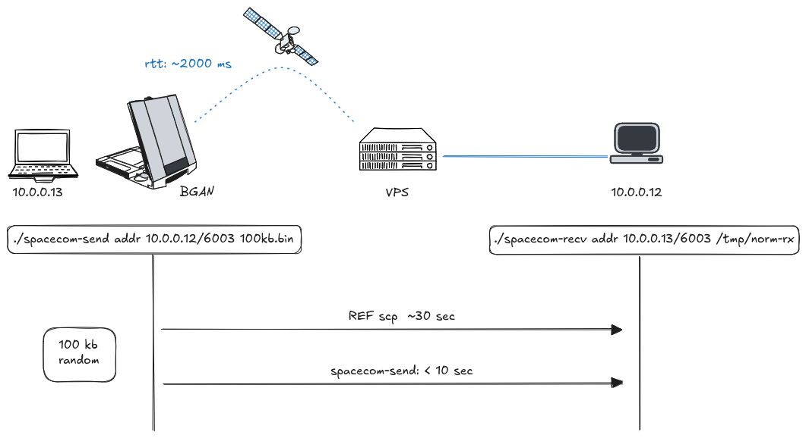

# spacecom

Tiny standalone NORM-based file transfer tools for Debian/amd64 hosts using the
host-installed `libnorm-dev` package.




This project contains:

- `spacecom-send` — send one file with NORM
- `spacecom-recv` — receive one file with NORM into a cache/output directory

## Target environment

Example package:

```text
libnorm-dev/stable 1.5.9+dfsg-3.1+b2 amd64
```

## Build

```sh
make
```

If pkg-config metadata is unavailable:

```sh
make NORM_CFLAGS='-I/usr/include' NORM_LIBS='-lnorm -lpthread'
```

## Unicast usage

Receiver host `10.0.0.4`:

```sh
mkdir -p /tmp/norm-rx
./spacecom-recv addr 10.0.0.10/6003 /tmp/norm-rx
```

Sender host `10.0.0.10`:

```sh
./spacecom-send addr 10.0.0.4/6003 /path/to/file
```

For unicast, sender uses the receiver IP and receiver uses the sender IP.

## Notes

- Sender segment size defaults to 1000 bytes.
- Receiver waits 5 seconds after completion before exiting.
- This is a simple exploration tool, not hardened production software.
